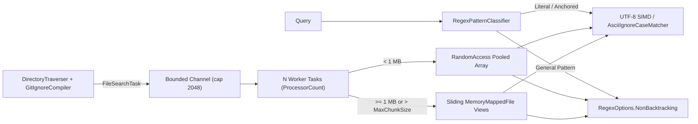

# Glacier.Grep Architecture

`Glacier.Grep` combines stack-allocated ignore-aware directory enumeration, hybrid I/O chunking, and pattern-lowering SIMD scanners across a bounded producer-consumer pipeline.

---

## Pipeline Overview

---

## Key Components

### 1. Zero-Allocation Directory Pruning (`DirectoryTraverser`, `GitIgnoreCompiler`)

- Built directly on `System.IO.Enumeration.FileSystemEnumerable<FileSearchTask>` using `ShouldIncludePredicate` and `ShouldRecursePredicate`.
- Paths under `<= 1024` characters are normalized in-place on `stackalloc char` spans without heap strings.
- `.gitignore`, `.ignore`, and `.rgignore` files load lazily per directory and cache `GitIgnoreFile` matchers by span lookup.

### 2. Bounded Producer-Consumer Channel (`SearchEngine`)

- One producer thread enumerates files into `Channel.CreateBounded<FileSearchTask>(2048)` while `Environment.ProcessorCount` worker tasks drain tasks concurrently, preventing unbounded memory growth on massive directory trees.
- Per-file sharing violations on active files are caught individually without aborting the search, while `OperationCanceledException` and invalid regex patterns propagate immediately.

### 3. Hybrid I/O & UTF-8 Boundary Framing (`HybridIoDispatcher`)

- **Small files (`< 1 MB` and `<= MaxChunkSize`):** Read once via `RandomAccess` into pooled buffers.
- **Large files (`>= 1 MB` or `> MaxChunkSize`, default 16 MB):** Mapped in sliding 64 KB-aligned `MemoryMappedFile` views.
- **Cross-chunk integrity:** Chunks advance on valid UTF-8 codepoint boundaries and pass an overlap margin + `precedingByte`/`precedingRune` context (`ProcessFileWithPrecedingByte`) so multiline regex matches and line numbers never duplicate or split across chunk seams.

### 4. Pattern Classification & SIMD Scanning (`RegexPatternClassifier`, `AsciiIgnoreCaseMatcher`)

- Before invoking full `Regex` machinery, `RegexPatternClassifier.ClassifyPatternFull` inspects regex strings for simple forms (`Literal`, `StartsWith`, `EndsWith`, `Equals`, `PrefixAndSuffix`, `ContainsBothOrdered`) when safe under `Multiline` semantics.
- Literal UTF-8 searches avoid decoding files into UTF-16 `string` instances except for matching lines and requested context lines, using SIMD byte comparisons (`Vector256` / `Vector128`) and `AsciiIgnoreCaseMatcher`.
